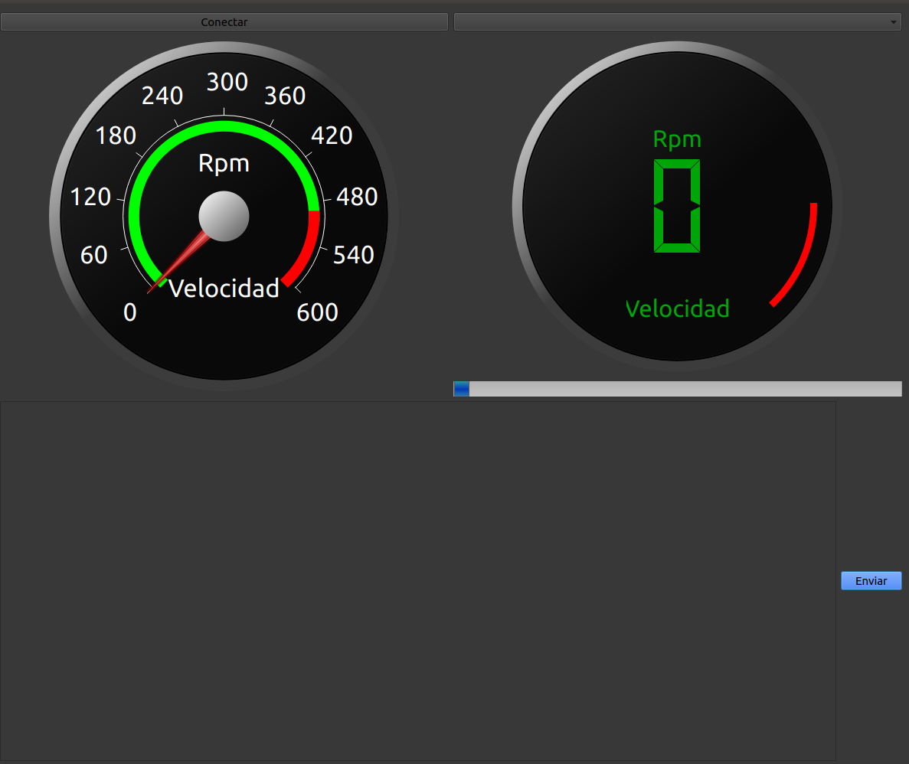

# ⚡ Brushless Motor Monitor — Qt HMI Dashboard

> Desktop HMI in C++/Qt for monitoring and sending speed setpoints to a brushless DC motor (Hall effect sensors) driven by a microcontroller over a serial link (115200 baud, 8N1). Packaged as a self-contained Linux AppImage with linuxdeployqt.

[](https://en.wikipedia.org/wiki/C%2B%2B)
[](https://www.qt.io/)
[](https://doc.qt.io/qt-5/qserialport.html)
[](https://appimage.org/)
[](LICENSE)

---

## Table of Contents

- [About](#about)
- [Screenshot](#screenshot)
- [Features](#features)
- [Architecture](#architecture)
- [Project Structure](#project-structure)
- [Technologies Used](#technologies-used)
- [Download & Run (AppImage)](#download--run-appimage)
- [Building from Source](#building-from-source)
- [Serial Protocol](#serial-protocol)
- [Usage](#usage)
- [Known Limitations](#known-limitations)
- [Credits](#credits)

---

## About

This Qt Widgets application is the PC-side HMI for a **brushless DC motor** with **Hall effect sensors** controlled by a microcontroller (MCU). It connects to the MCU over a serial port (115200 baud, 8 data bits, no parity, 1 stop bit), displays the incoming value on an analog meter, and sends a speed setpoint back using a simple framed protocol.

The interface uses two analog instruments, **`QGauge`** (speedometer-style dial) and **`QMeter`** (needle meter with a threshold arc). Both are based on the open-source widgets by P. Sereno (see [Credits](#credits)); in this project they are integrated, configured (0–100 range, numeric readout, threshold at 80 on the meter) and wired to the serial link and the controls of the main dialog.

The app is distributed as a **Linux AppImage** built with **linuxdeployqt**, which bundles the Qt shared libraries so it runs on a Linux x86_64 machine without a Qt installation.

> The MCU firmware is **not** part of this repository; the protocol it must implement is described in [Serial Protocol](#serial-protocol).

---

## Screenshot



---

## Features

- **Serial port discovery** — the available ports are listed in a dropdown when the app starts.
- **Connect / Disconnect** toggle (button switches between *Conectar* and *Desconectar*).
- **`QMeter` (analog meter)** — shows the value received from the MCU (and follows its own slider for local testing); includes a green/red threshold arc set at 80 and a numeric readout.
- **`QGauge` (speedometer dial)** — range 0–100 with numeric readout, driven by the speed slider.
- **Speed setpoint** — the speed slider plus the **Enviar** button sends a framed command `#<value>&` to the MCU.
- **Incoming data validation** — only values in the accepted range are shown; anything else is discarded.
- **Self-contained AppImage** — runs on Linux x86_64 without Qt installed.

---

## Architecture

```
┌─────────────────────────────────────────────────────────────┐
│                  Qt Application (AppImage)                  │
│                                                             │
│  ┌────────────────────────────────────────────────────┐     │
│  │  Dialog  (main window, dialog.cpp / dialog.ui)     │     │
│  │                                                    │     │
│  │   ┌──────────────┐       ┌────────────────────┐   │     │
│  │   │   QGauge     │       │     QMeter         │   │     │
│  │   │ (speed dial) │       │ (needle + threshold│   │     │
│  │   │              │       │  arc at 80)        │   │     │
│  │   └──────▲───────┘       └────────▲───────────┘   │     │
│  │          │ setValue()             │ setValue()     │     │
│  │      Slider_Vel              serial data +        │     │
│  │   (also the setpoint)        horizontalSlider     │     │
│  │   ┌──────┴────────────────────────┴────────────┐   │     │
│  │   │          QSerialPort  (115200, 8N1)        │   │     │
│  │   │  readyRead() ──▶ parse int ──▶ QMeter      │   │     │
│  │   │  write()     ◀── '#' <setpoint> '&'        │   │     │
│  │   └───────────────────────┬────────────────────┘   │     │
│  └───────────────────────────┼────────────────────────┘     │
└──────────────────────────────┼──────────────────────────────┘
                               │  USB / UART
┌──────────────────────────────▼──────────────────────────────┐
│                    Microcontroller (MCU)                    │
│         Brushless DC Motor + Hall Effect Sensors            │
│                                                             │
│   Sends    →  value as ASCII integer  (e.g. "75")           │
│   Receives →  '#' <setpoint byte> '&'                       │
└─────────────────────────────────────────────────────────────┘
```

---

## Project Structure

```
speedometer_qt/
├── README.md
├── LICENSE
├── assets/
│   └── screenshot.png
└── speedometer/
    ├── main.cpp                       # Application entry point
    ├── interfaz.pro                   # QMake project file (target: SerialTerminal)
    │
    ├── dialog.cpp / dialog.h          # Main window: serial port, gauges,
    ├── dialog.ui                      #   sliders and setpoint sender (Qt Designer layout)
    │
    ├── QGauge/
    │   ├── qgauge.h / qgauge.cpp      # Analog speedometer widget
    │   └── qgaugedrawfunctions.cpp    # QPainter draw routines
    │
    ├── QMeter/
    │   ├── qmeter.h / qmeter.cpp      # Analog meter widget
    │   └── qmeterdrawfunctions.cpp    # QPainter draw routines
    │
    ├── mainwindow.cpp / .h / .ui      # Alternative window (serial log + dial + LCD).
    │                                  #   NOT part of the current build (not in interfaz.pro)
    └── Gauge.qml                      # Qt Quick CircularGauge reference file.
                                       #   NOT used by the current build
```

---

## Technologies Used

| Technology | Role |
|---|---|
| **C++** | Application logic, serial handling, widget integration |
| **Qt Widgets** | Main dialog, sliders, buttons, combo box, LCD numeric indicators |
| **Qt SerialPort** | Bidirectional serial communication with the MCU (115200 baud, 8N1) |
| **QPainter** | Analog needle/arc rendering in `QGauge` and `QMeter` (`*drawfunctions.cpp`) |
| **QMake** | Build system (`interfaz.pro`) |
| **linuxdeployqt** | AppImage packaging — bundles the Qt `.so` dependencies |

---

## Download & Run (AppImage)

The pre-built AppImage is distributed through **GitHub Releases** (too large to commit to the repository).

**➡ [Download the latest AppImage from the Releases page](../../releases/latest)**

```bash
# 1. Make it executable
chmod +x Brushless_Motor_Monitor-x86_64.AppImage

# 2. Run it — no Qt installation required
./Brushless_Motor_Monitor-x86_64.AppImage
```

> **Note:** AppImages need FUSE. If you get a FUSE error, extract and run directly:
> ```bash
> ./Brushless_Motor_Monitor-x86_64.AppImage --appimage-extract
> ./squashfs-root/AppRun
> ```

---

## Building from Source

### Prerequisites

- Qt 5.x with the **Qt Widgets** and **Qt SerialPort** modules (project created with Qt Creator 4.5; Qt 6 has not been verified)
- `g++` or `clang++`
- `qmake` in your `PATH`

Qt Quick / QML is **not** required.

### Steps

```bash
# 1. Clone the repository
git clone https://github.com/mtassone1/speedometer_qt.git
cd speedometer_qt/speedometer

# 2. Generate the Makefile
qmake interfaz.pro

# 3. Build
make -j$(nproc)

# 4. Run (the target defined in interfaz.pro is SerialTerminal)
./SerialTerminal
```

### Re-packaging as AppImage (optional)

```bash
# After building, bundle the Qt dependencies with linuxdeployqt
linuxdeployqt SerialTerminal -appimage
```

---

## Serial Protocol

Minimal ASCII/binary protocol over serial (115200 baud, 8 data bits, no parity, 1 stop bit):

| Direction | Format | Description |
|---|---|---|
| MCU → App | `<integer>` as ASCII text | Value shown on the `QMeter`. Accepted range: **2–99**; any other value (or text that is not a number) is discarded. |
| App → MCU | `'#'` + 1 byte + `'&'` | Speed setpoint. The middle byte is the **raw numeric value** of the slider (0–99), **not** its ASCII digits. |

**Example:**

```
MCU sends:   "75"                  → QMeter shows 75
App sends:   0x23 0x32 0x26        → '#', byte 50 (0x32), '&'  → MCU should set setpoint 50
```

> Because the setpoint is a raw byte, a value of 50 appears as the character `2` (0x32) in a text terminal. The MCU firmware must read it as a number, not parse ASCII digits.

---

## Usage

1. Connect the MCU to the computer via USB/UART.
2. Launch the AppImage (or the built `SerialTerminal` binary).
3. Select the serial port from the dropdown.
4. Click **Conectar** — the button changes to **Desconectar** when the port opens. If the port cannot be opened, the button stays as *Conectar*.
5. Incoming values from the MCU move the **QMeter** needle.
6. Move the **speed slider** (it also moves the **QGauge** locally) and press **Enviar** to send the setpoint `#<value>&` to the MCU. Without an open port the status field shows *"No hay puerto abierto"*.
7. Click **Desconectar** or close the app to release the port.

---

## Known Limitations

- The incoming data is read in chunks as they arrive; if the MCU sends several values per chunk or a value is split across chunks, that read is discarded by the range check.
- The `QGauge` is driven by the speed slider, not by the MCU; only the `QMeter` displays MCU data.
- `mainwindow.*` (serial log, dial and LCD) and `Gauge.qml` are kept in the repository but are not compiled into the current build.
- Setpoint resolution is 0–99 (default range of the Qt slider).

---

## Credits

- `QGauge` and `QMeter` are based on the Qt widgets by **P. Sereno** (© 2016, [qt-italia.net](http://www.qt-italia.net)), integrated and configured for this project. Their source files keep the original copyright header.
- Application code (serial communication, dialog logic, UI layout, packaging) by **Matías Blas Tassone**, released under the [MIT License](LICENSE).
